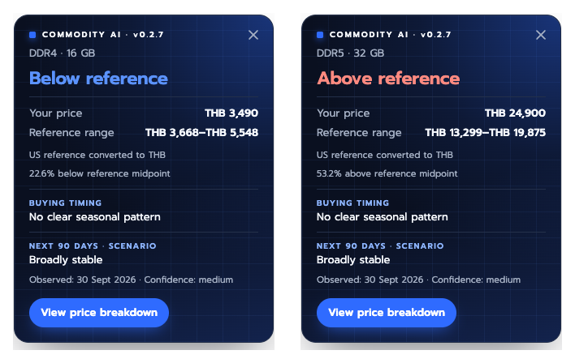
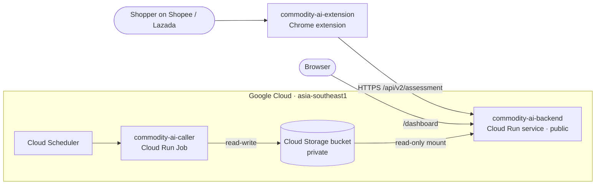

# Commodity AI — Chrome extension

Check a RAM, SSD or graphics-card price **before you pay**. On a Shopee Thailand or Lazada Thailand product page, the
extension reads the listing title, the option you selected and its price, and shows whether the price is **below,
within or above a reference range**, plus buying timing and a 90-day outlook. "View price breakdown" opens the full
price receipt on [commodity.cloud.run](https://commodity.cloud.run).



Covers DDR4 and DDR5 RAM, NVMe and SATA SSDs, and graphics cards. Prices are in THB.

## Install

The extension is not on the Chrome Web Store yet, so it is installed in developer mode (about a minute):

1. Open **[Releases](../../releases/latest)** and download `commodity-ai-extension-<version>.zip`.
2. Unzip it. Keep the folder; Chrome loads the extension from it.
3. Open `chrome://extensions` in Chrome (or `edge://extensions` in Edge) and turn on **Developer mode** (top right).
4. Click **Load unpacked** and choose the unzipped folder.
5. Open a RAM, SSD or GPU product page on Shopee or Lazada. The badge appears at the top right.

To update, download the new release, replace the folder and click the reload icon on the extension's card.

## How to read the badge

- **Below / Within / Above reference:** the listing price compared with a reference range built from US prices (retail
  price index, deal posts, chip spot prices) converted to THB. It is a reference, not a calibrated Thai market price,
  and category references do not account for every brand, speed or warranty.
- **Provisional:** shown when the selected option or capacity could not be confirmed. Check the option on the page.
- **Buying timing** and **Next 90 days:** seasonal context and an outlook. A *scenario* is illustrative, not a
  validated forecast.

## Privacy

- Sent to the Commodity AI API (`https://commodity.cloud.run`) for each product page: the listing title, the selected
  option label, the price, and which part of the page they came from. No account details, cookies or browsing history
  are read or sent.
- Stored in the browser: only the API address setting (`chrome.storage.sync`).
- Permissions: Shopee Thailand, Lazada Thailand and the API origin. The bundled Prompt font is the only file the shop
  pages can load from the extension.

## Settings

Right-click the extension icon → **Options** to change the API address (for example `http://localhost:8000` when running
[commodity-ai-backend](https://github.com/MobyDIGG-commidtyAI/commodity-ai-backend) locally) and test the connection.

## Development

```bash
node --test extension/test/                      # badge, parser and option-selection tests
pip install -r requirements-dev.txt && python -m pytest -q
python scripts/build_extension.py https://commodity.cloud.run   # release zip in dist/
```

The source in `extension/` defaults to `http://localhost:8000`; the release build points at the given HTTPS origin and
narrows `host_permissions` to the shops plus that origin. Details on the badge and receipt:
[extension/README.md](extension/README.md).

## Architecture



## License

MIT
