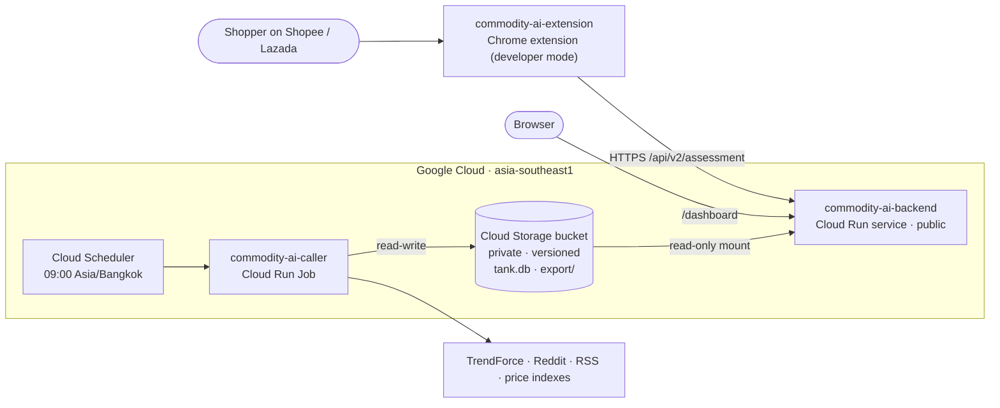

# Commodity AI — Chrome extension

On a Shopee Thailand or Lazada Thailand product page for RAM (DDR4/DDR5), an SSD (NVMe/SATA) or a GPU, the extension reads
the listing title, the selected option and its price, asks the
[Commodity AI API](https://github.com/MobyDIGG-commidtyAI/commodity-ai-backend) and shows a badge: below, within or above the
reference range, buying timing and the 90-day outlook. "View price breakdown" opens the full price receipt.

## Architecture



## Install (developer mode)

1. Download `commodity-ai-extension-<version>.zip` from the latest release and unzip it
   (or use the `extension/` folder of this repo for a local API on `http://localhost:8000`).
2. Open `chrome://extensions`, turn on **Developer mode**, click **Load unpacked** and pick the folder.
3. Open a RAM, SSD or GPU product page on Shopee or Lazada.

The extension is not on the Chrome Web Store yet (store review takes time).

## Release build

```bash
python scripts/build_extension.py https://<cloud-run-api-url>
```

Writes `dist/commodity-ai-extension-<version>.zip` with that API as the default and `host_permissions` narrowed to the shops
plus that one origin.

## Test

```bash
node --test extension/test/
pip install -r requirements-dev.txt && python -m pytest -q
```

More detail on the badge and receipt: [extension/README.md](extension/README.md).

## License

MIT
